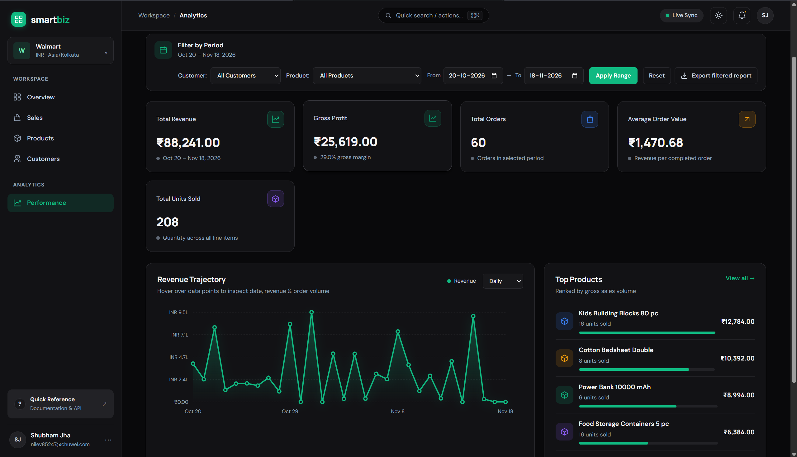
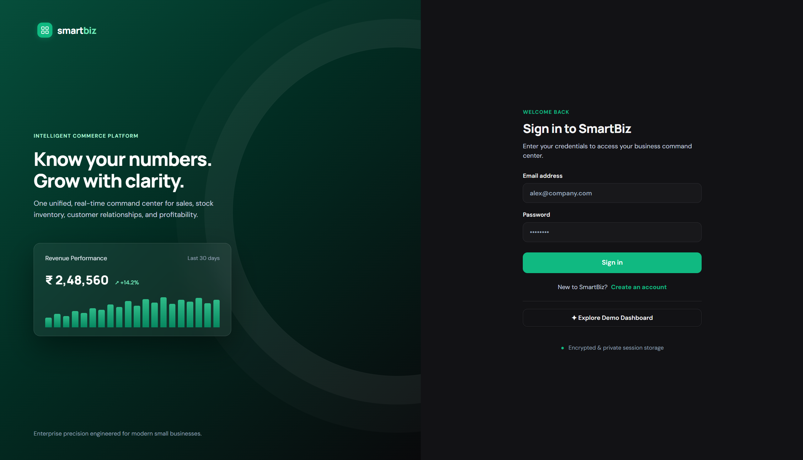
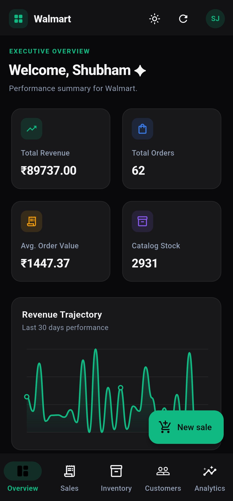
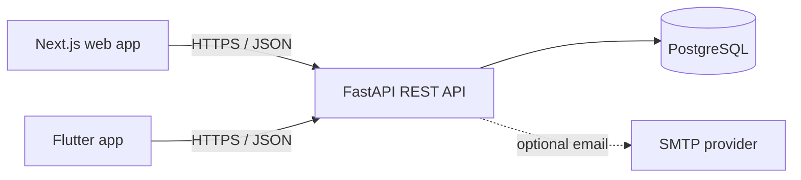

# SmartBiz

SmartBiz is a small-business platform for managing customers, products, inventory, and sales in one workspace. It includes a responsive web dashboard and a Flutter mobile companion, backed by a shared REST API and PostgreSQL database.

**Hosted web app:** [smartbiz-web-qu8e.onrender.com](https://smartbiz-web-qu8e.onrender.com)

## Screenshots

### Web analytics dashboard

The dashboard shows revenue, gross profit when sale costs are available, order and unit totals, a revenue trend, top products, and customer, product, and date filters.



<details>
<summary>Sign-in and Flutter mobile screens</summary>

### Web sign-in



### Flutter mobile overview



</details>

## What’s included

- **Business workspaces and access:** account registration, email verification, profile and password settings, business memberships, invitations, and role-based access.
- **Products and inventory:** create and maintain a catalog, track stock, record cost and selling prices, and deactivate products while preserving their sales history.
- **Customers:** maintain customer records, review purchase history, and see customer sales metrics.
- **Sales:** record multi-item sales, update stock transactionally, edit or remove sales, and print a sales receipt.
- **CSV imports:** import product, customer, and historical sales data with previews, validation, row-level feedback, and flexible sales-column mapping. Sales imports can include unit cost at the time of sale.
- **Analytics and reporting:** filter sales by customer, product, and date; review dashboard totals, revenue trends, top products, gross profit and margin when costs are known; export filtered sales to CSV.
- **Flutter companion:** sign in, review business performance, manage core product, customer, and sales workflows, and record sales from a mobile device.
- **Account security:** hashed passwords, signed access tokens, refresh-token rotation, workspace authorization, and database constraints.

Sales imports preserve historical dates and do not change current stock. Gross profit is calculated from sale-line cost snapshots; it remains unavailable for sales whose costs are missing.

## Technology and architecture

- **Web:** Next.js, React, TypeScript, and responsive custom CSS
- **Mobile:** Flutter and Dart
- **API:** Python, FastAPI, Pydantic, and SQLAlchemy
- **Database:** PostgreSQL with Alembic migrations
- **Local services:** Docker Compose
- **Hosting:** Render web service, API service, and managed PostgreSQL



## Run locally with Docker

Install Docker Desktop, then from the repository root:

```powershell
if (-not (Test-Path .env)) { Copy-Item .env.example .env }
```

Edit `.env` and replace `DB_PASSWORD` and `JWT_SECRET` with unique random values. Keep `.env` private; it is excluded from Git. Then start the web app, API, and database:

```powershell
docker compose up --build
```

- Web app: <http://localhost:3000>
- API: <http://localhost:8000>
- Interactive API documentation: <http://localhost:8000/docs>
- API liveness: <http://localhost:8000/health>
- API readiness: <http://localhost:8000/ready>

The API applies database migrations when it starts. PostgreSQL is not exposed on the host by default. To connect a desktop database client, start the local override instead:

```powershell
docker compose -f docker-compose.yml -f docker-compose.local.yml up --build
```

The override maps PostgreSQL to `127.0.0.1:5433`. Use the database name, user, and password from `.env`.

## Run the web app separately

Start PostgreSQL and the API with Docker Compose, then open another terminal:

```powershell
cd web
npm install
$env:NEXT_PUBLIC_API_URL = "http://localhost:8000"
npm run dev
```

The web app will be available at <http://localhost:3000>.

## Run the Flutter app

Start the API and PostgreSQL first. From a separate terminal:

```powershell
cd mobile
flutter pub get
flutter run --dart-define=API_BASE_URL=http://10.0.2.2:8000
```

`10.0.2.2` connects an Android emulator to the host computer. For a physical device, use the computer’s reachable local network address and make sure the API is accessible from that device. See [mobile/README.md](mobile/README.md) for Android build and Chrome preview instructions.

## Data, analytics, and API

All business data is scoped to a workspace. Authenticated business requests use a bearer token and the selected `X-Business-Id`; the API enforces membership and role permissions.

The main API groups cover authentication, business memberships, customers, products, sales, analytics, and reports. Useful endpoints include:

| Endpoint | Purpose |
|---|---|
| `GET /api/v1/dashboard/summary` | Filtered dashboard metrics, including gross profit when costs are complete |
| `GET /api/v1/analytics/sales-trend` | Daily, weekly, or monthly revenue trend |
| `GET /api/v1/analytics/top-products` | Product units and sales performance |
| `GET /api/v1/sales` | Search and filter sales records |
| `GET /api/v1/reports/sales.csv` | Export matching sales line items as CSV |

Analytics and report filters support inclusive `from_date` and `to_date` values in `YYYY-MM-DD` format, plus customer and product filters where applicable. Date ranges are interpreted in the business timezone and are limited to 366 days. Money is stored in integer minor units; for INR, `5000` represents ₹50.00.

Product CSV columns include `name`, `sku`, `price`, `cost_price`, and `stock_quantity`. Customer imports accept `name`, `email`, and `phone`. Sales imports map source headers to sale reference, date, customer, product SKU, quantity, unit price, and optional unit cost. Include `unit_cost` for historical gross-profit reporting.

## Email configuration

SMTP is optional for local development. Without SMTP, the API provides a manual email-verification link. To send verification and invitation emails, configure `SMTP_HOST`, `SMTP_PORT`, `SMTP_USERNAME`, `SMTP_PASSWORD`, `SMTP_FROM_EMAIL`, `SMTP_TLS_MODE`, and `APP_BASE_URL` in `.env` or the hosting provider’s environment settings. Never commit real credentials.

## Render deployment

The web app, API, and PostgreSQL database run as separate Render services. The repository includes Dockerfiles and a `render.yaml` configuration. For the existing manually configured services, use the URLs assigned by Render and set:

- `NEXT_PUBLIC_API_URL` on the web service to the API’s public HTTPS URL
- `APP_BASE_URL` and `WEB_ORIGINS` on the API to the web app’s exact HTTPS origin
- `DATABASE_URL` to the managed PostgreSQL connection string
- `JWT_SECRET` to a unique secret
- SMTP settings if email delivery is required

If Render auto-deploy is enabled for `main`, a push can trigger a deployment. Check the Render build logs and `/ready` endpoint after backend changes.

## Repository layout

```text
backend/       FastAPI application, data models, and Alembic migrations
web/           Next.js application
mobile/        Flutter Android/iOS application
docs/          Architecture notes and README screenshots
```
