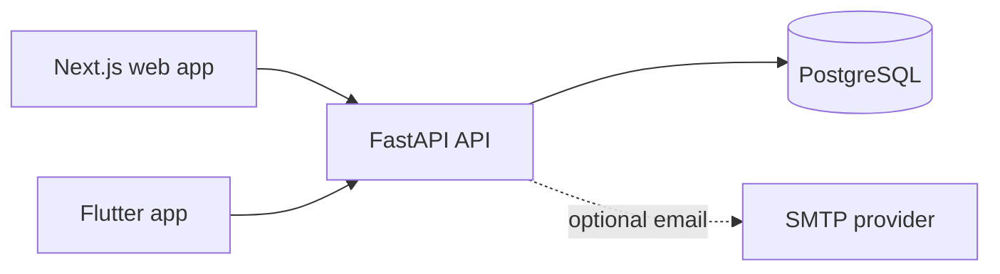

# SmartBiz

SmartBiz helps small businesses manage sales, inventory, customers, and business performance from one workspace. The web dashboard and Flutter mobile app use the same API and PostgreSQL database.

**Live web app:** [smartbiz-web-qu8e.onrender.com](https://smartbiz-web-qu8e.onrender.com)

## Screenshots

### Analytics dashboard

Review revenue, gross profit, orders, units sold, sales trends, and top products. Filter reports by customer, product, and date.


<details>
<summary>Sign-in and mobile app</summary>


</details>

## What you can do

- **Track products and stock:** create and update products, prices, costs, and inventory. Deactivated products remain in past sales records.
- **Manage customers:** keep customer details and review purchase history and sales metrics.
- **Record and maintain sales:** create sales with multiple products, correct or remove records, and generate receipts. Stock updates with sales.
- **Import and export data:** import customers, products, and sales from CSV with column mapping, previews, and validation. Export filtered sales reports as CSV.
- **Understand performance:** filter dashboard results by customer, product, and date, then review revenue, gross profit, trends, and top products.
- **Use it across devices:** work from the responsive web dashboard or the Flutter app.
- **Manage workspace access:** create businesses, manage members and invitations, and update account settings.

Gross profit uses the cost captured for each sale line. It is only available when the sales being reported have cost data. Historical sales imports preserve their dates and do not change current stock.

## Technology

| Part | Technology |
|---|---|
| Web dashboard | Next.js, React, TypeScript |
| Mobile app | Flutter, Dart |
| API | Python, FastAPI, SQLAlchemy |
| Database | PostgreSQL, Alembic migrations |
| Local development | Docker Compose |
| Hosting | Render |



## Run the full project locally

### Requirements

- Docker Desktop with Docker Compose
- Git, if you are cloning the repository

### Start SmartBiz

From the project root, create your local environment file:

```powershell
Copy-Item .env.example .env
```

Open `.env` and replace `DB_PASSWORD` and `JWT_SECRET` with unique random values. Keep `.env` private; it contains local secrets and is excluded from Git. Then build and start the services:

```powershell
docker compose up --build
```

Once the services are ready, open:

- Web dashboard: <http://localhost:3000>
- API: <http://localhost:8000>
- API documentation: <http://localhost:8000/docs>
- API readiness: <http://localhost:8000/ready>

The API runs database migrations when it starts. SMTP is optional for local development; without it, the API provides a manual verification link.

To stop the services, press `Ctrl+C`. To start them in the background, add `-d` to `docker compose up`; stop background services with `docker compose down`. Your database is stored in a Docker volume and remains when the services stop.

### Connect a database desktop app (optional)

PostgreSQL is private to the Docker network by default. To expose it only on your local computer at port `5433`, start the local override:

```powershell
docker compose -f docker-compose.yml -f docker-compose.local.yml up --build
```

Connect your database client to host `127.0.0.1`, port `5433`, and use the database name, username, and password from `.env`.

## Run the web app separately

Start the API and database from the project root:

```powershell
docker compose up --build -d api
```

Then open another terminal and run the Next.js development server:

```powershell
cd web
npm ci
$env:NEXT_PUBLIC_API_URL = "http://localhost:8000"
npm run dev
```

Open <http://localhost:3000>. Stop the web server with `Ctrl+C`.

## Run the Flutter app

Start the API and database as described above. Install Flutter and Android Studio, start an Android emulator, then run:

```powershell
cd mobile
flutter pub get
flutter run --dart-define=API_BASE_URL=http://10.0.2.2:8000
```

`10.0.2.2` is the Android emulator address for services running on your computer. On a physical device, use your computer’s local network IP address instead. For a browser preview, see [mobile/README.md](mobile/README.md).

## Data and reports

All customer, product, and sales records belong to a business workspace. The API checks the signed-in user’s workspace membership before allowing access.

CSV imports support:

- **Products:** `name`, `sku`, `price`, `cost_price`, and `stock_quantity`
- **Customers:** `name`, `email`, and `phone`
- **Sales:** map your file’s headers to sale date/reference, customer, product SKU, quantity, unit price, and optional unit cost

Including unit cost in a sales import enables historical gross-profit reporting. API routes and interactive request examples are available at <http://localhost:8000/docs> while running locally.

## Deployment

The deployed application uses three Render services: the web app, the API, and PostgreSQL. The repository contains the Dockerfiles and `render.yaml` service configuration. Set production URLs and credentials in Render’s environment settings, not in source files. The web service needs `NEXT_PUBLIC_API_URL`; the API needs `DATABASE_URL`, `JWT_SECRET`, `APP_BASE_URL`, and `WEB_ORIGINS`. SMTP settings are needed to deliver verification and invitation email.

If automatic deployment is enabled for `main`, pushing a change can start a Render deployment. Check the Render build logs and API `/ready` endpoint after deployment.

## Project folders

```text
backend/       FastAPI API, database models, and migrations
web/           Next.js web dashboard
mobile/        Flutter app
docs/          Architecture notes and README screenshots
```

For design decisions and detailed system structure, see [docs/architecture.md](docs/architecture.md).
