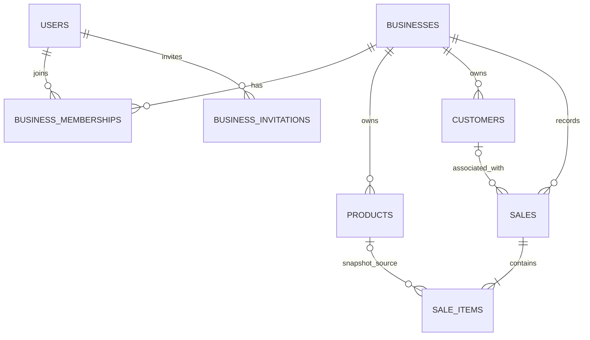

# SmartBiz Architecture and Syllabus Implementation

This document describes the SmartBiz system as it is implemented in this repository, records how it maps to the 18-task syllabus plan chosen at project kickoff, and lists the intentional scope changes and remaining work. It is an implementation record, not a claim that every planned feature is finished.

## 1. Project purpose

SmartBiz is a small-business sales, customer, product, and inventory application with live operational analytics. A user can create a business account, manage business records, record or import sales, and explore sales results through a web dashboard. A Flutter companion app uses the same API for a smaller set of workflows.

The core end-to-end path is:

1. A user signs up, verifies an email address, and signs in.
2. The user creates or joins a business workspace.
3. Authorized staff add products and customers or import CSV files.
4. Staff record sales; the API validates the request, saves the order and line items, and updates stock for live sales.
5. The web and mobile clients read the same PostgreSQL-backed API. Dashboard filters and CSV reports use the selected business and date range.

## 2. Architecture at a glance

SmartBiz is a **modular monolith**. The browser client, mobile client, API, and database are separate deployable/runtime components, but the API is one application and one codebase. PostgreSQL is the source of truth.

```mermaid
flowchart LR
  Browser[Next.js web dashboard] -->|HTTPS JSON / bearer token| API[FastAPI REST API]
  Mobile[Flutter companion app] -->|HTTP(S) JSON / bearer token| API
  API -->|SQLAlchemy / psycopg| DB[(PostgreSQL)]
  API -->|SMTP when configured| Mail[Email provider]
  GitHub[Private GitHub repository] -->|Render deploy from main| WebHost[Render web service]
  GitHub -->|Render deploy from main| ApiHost[Render API service]
  ApiHost --> DBHost[(Render PostgreSQL)]
  WebHost --> Browser
  ApiHost --> API
```

### Runtime responsibilities

| Component | Responsibility | Implementation |
|---|---|---|
| Web client | Authentication UI, workspace navigation, data entry, tables, filters, dashboard, CSV import/export actions | Next.js App Router, React, TypeScript, custom CSS |
| Mobile client | Sign-in/registration, summary, sales and product views, recording a sale | Flutter, Dart, `http` package |
| API | Authentication, authorization, validation, business rules, imports, reporting | FastAPI, Pydantic, SQLAlchemy 2 |
| Database | Durable business and account records, unique/check/FK constraints | PostgreSQL 16, Alembic migrations |
| Email | Verification, invitations, and pending email-change confirmation | SMTP adapter; manual verification links when SMTP is not configured |
| Deployment | Build and run separate web/API services and managed database | Docker, Docker Compose locally, Render in hosted environment |

## 3. Technology choices and changes from the kickoff proposal

The first project blueprint proposed React/Vite/Bootstrap, Express/Prisma, Power BI, Flutter, GitHub Actions, and PostgreSQL. The implementation uses alternatives in several areas:

| Area | Kickoff proposal | Implemented choice | Reason / effect |
|---|---|---|---|
| Web | React + Vite + Bootstrap | Next.js 15, React 19, TypeScript, custom CSS | Next.js supports the deployed dashboard and its production build; Bootstrap is not currently a dependency. |
| API | Node.js + Express + Prisma + Zod | Python 3.12 + FastAPI + Pydantic + SQLAlchemy | FastAPI supplies typed REST endpoints and OpenAPI docs; migrations use Alembic. |
| Database | PostgreSQL + Prisma | PostgreSQL 16 + SQLAlchemy + Alembic | Relational database and versioned schema migrations remain as planned. |
| Web charts / BI | Chart.js and Power BI | API-driven SVG sales trend and top-product dashboard | A dedicated Power BI report, DAX measures, and published BI artifacts are still future work. |
| Hosting | Generic cloud host | Render web service, API web service, managed PostgreSQL | Render configuration and Dockerfiles are in the repository. |
| CI | GitHub Actions | Render deploys from GitHub; no GitHub Actions workflow is present | Automated build/test checks in GitHub remain future work. |

These are implementation choices, not a claim that the initially proposed libraries were used.

## 4. Repository layout

```text
SmartBiz/
├── backend/
│   ├── app/                 # API routes, schemas, models, auth, email, DB setup
│   ├── migrations/          # Alembic migration history
│   ├── Dockerfile
│   ├── alembic.ini
│   └── pyproject.toml
├── web/
│   ├── app/                 # Next.js routes, dashboard, forms, styles
│   ├── public/
│   ├── Dockerfile
│   ├── package.json
│   └── package-lock.json
├── mobile/
│   ├── lib/                 # Flutter screens and API client
│   ├── android/ and ios/    # Native project targets
│   ├── pubspec.yaml
│   └── pubspec.lock
├── docs/architecture.md     # This document
├── sample_imports/          # Local synthetic CSV samples; ignored by Git
├── docker-compose.yml
├── docker-compose.local.yml # Optional local PostgreSQL port mapping
├── render.yaml
├── .env.example              # Placeholder configuration only
└── README.md
```

Actual secrets belong in `.env` locally or the hosting provider's environment settings. They must not be added to the repository or archive.

## 5. Data model

### Implemented tables

| Table | Main fields and purpose |
|---|---|
| `users` | Unique email, full name, password hash, email verification and active flags, creation time. |
| `businesses` | Workspace name, ISO currency, IANA timezone. |
| `business_memberships` | User-to-business relationship and role (`owner`, `admin`, `sales`, `viewer`); unique per user/business. |
| `business_invitations` | Business, invited email, role, hashed one-time token, expiry, acceptance time. |
| `token_revocations` | Token ID and expiry, enabling immediate logout revocation. |
| `email_verifications` | Hashed one-time verification token, optional pending email, expiry. |
| `rate_limit_buckets` | Database-backed per-minute authentication rate limits. |
| `customers` | Business-scoped name, optional email and phone. |
| `products` | Business-scoped name and SKU, integer minor-unit price, current stock, active flag. |
| `sales` | Business, optional customer, total in integer minor units, currency, optional external reference, UTC creation time. |
| `sale_items` | Sale, optional product reference, product-name and unit-price snapshot, quantity. |

### Relationships and constraints



- Products are unique by `(business_id, sku)`; customers are unique by `(business_id, email)` where database null semantics allow multiple blank emails.
- Product stock and prices, sale totals, sale-line unit prices, and quantities have database checks preventing negative values; quantity must be greater than zero.
- Deleting a customer or product preserves historical sales: optional foreign keys become null and sale-line product name/price snapshots remain.
- Imported sale references are unique within a business to prevent duplicate historical imports.
- Money is stored as integer minor units. For INR, `5000` means ₹50.00; calculations do not use floating-point currency values.
- Category, supplier, region, payment, stock-movement, and order-status-history tables from the broader initial vision are **not** implemented. Product currently has no category or supplier relationship.

## 6. API and request flow

The API base path is `/api/v1`. Interactive OpenAPI documentation is served by FastAPI at `/docs`; health endpoints are `/health` and `/ready`.

### Main API groups

| Group | Implemented operations |
|---|---|
| Authentication | Register, login, verify email, inspect account, update profile name, request email change, change password, logout, accept invitation |
| Business | Create/list workspaces, manage members, invite/revoke invitations, remove members |
| Customers | List/create/update/delete, CSV import |
| Products | List/create/update/delete/deactivate, CSV import |
| Sales | List/create/update/delete, CSV import |
| Analytics | Dashboard summary, sales trend, top products |
| Reports | Filtered line-item sales CSV export |

Sales list, summary, trend, top-products, and sales CSV endpoints support date filters; customer and product filters are supported for dashboard/report flows. Sales date parameters use inclusive `from_date` and `to_date` values in `YYYY-MM-DD` format. A range can span at most 366 calendar days. The CSV export rejects more than 50,000 matched sales rather than silently truncating.

### Business request context

Authenticated requests send `Authorization: Bearer <access-token>`. Business-scoped requests also send `X-Business-Id`. The API checks that the authenticated user belongs to that workspace before it queries or changes business data. The web client stores its token for the current browser tab session; the Flutter client keeps its token in memory for that app session.

### Sales write behavior

- A live sale validates that its customer and products belong to the selected business, locks/reconciles product stock transactionally, rejects insufficient stock, and snapshots product names and sale prices.
- Historical CSV imports validate and map records before confirmation. Imported historical sales preserve their dates and do not change current stock.
- Sale corrections reconcile inventory for live sales. Deleting a live sale restores its quantities; deleting an imported historical sale does not adjust current stock.

## 7. Authentication, authorization, and account security

- Passwords are hashed with Argon2 through `pwdlib`; plaintext passwords are not stored.
- Access tokens are signed HS256 JWTs with a 30-minute lifetime and unique token IDs. Logout stores the current ID in `token_revocations` until it expires.
- Registration requires email verification before sign-in. Verification links are single-use and expire after 24 hours. If SMTP is not configured, local/development flows return a manual verification URL.
- Email changes require the current password and keep the existing email active until the new address is verified. Password changes require the current password and a new password of at least eight characters.
- Authentication endpoints use PostgreSQL-backed fixed-minute rate limits by client address and normalized identity. Proxy forwarding headers are trusted only when `RATE_LIMIT_TRUST_PROXY=true`.
- Invitations contain token hashes in the database, expire after seven days, and are accepted by a signed-in account using the invited email.
- Role checks are enforced in the API. Owners and admins manage products; owners, admins, and sales roles can create customers and sales; all workspace roles can read permitted workspace records. Only owners grant admin access.
- Business queries are tenant-scoped. The API does not rely on hiding buttons in the browser for access control.

## 8. Web and mobile clients

### Web pages

Next.js routes render separate Overview (`/`), Sales (`/sales`), Products (`/products`), and Customers (`/customers`) screens. Analytics is an anchor/view within Overview. The common shell includes workspace navigation, account/profile/settings, responsive navigation, and connection status.

Current functionality includes:

- Overview KPIs, date trend, top products, and recent sales.
- Sales, customer, product, and date filters; matching filters are applied to list data, KPI/chart data, and CSV exports.
- Product/customer/sale entry and maintenance actions, role-aware controls, and loading/empty/error states.
- CSV import for products, customers, and sales. Product/customer imports validate rows; sales import supports arbitrary header names through column mapping, preview, saved per-business browser mappings, and row-level feedback.
- CSV report download and account settings for name, email (with verification), and password.
- Custom responsive CSS is used. Bootstrap is not included.

### Flutter app

The Flutter client has sign-in/registration, a business summary, sales and product listing, and live sale recording via the common API. The Android and iOS runner projects are included. It selects the account's first business membership in this initial implementation. The mobile app does not yet mirror every web workflow (for example CSV imports, customer maintenance, settings, or full analytics filters).

## 9. Data import and analytics

### Data sources

1. **Live application data:** records entered through web/mobile forms are stored in PostgreSQL and drive the application dashboard.
2. **CSV imports:** business-specific customers, products, and historical sales can be imported using schema validation and, for sales, user-defined column mapping.
3. **Synthetic samples:** `sample_imports/` contains sample CSVs for local demonstration. It is ignored by Git to keep demo records out of the repository; it is included in the reproducible project ZIP when present.
4. **External BI datasets:** the kickoff plan mentioned sources such as Tableau Sample Superstore and UCI Online Retail. They have not been added as a production data feed or Power BI artifact.

### Current dashboard measures

- Total revenue: sum of eligible sale totals within the selected date/customer/product filters. When a product is selected, revenue is calculated from that product's matching sale lines.
- Orders: count of matching sales; product-filtered reports count distinct orders containing the product.
- Average order value: filtered revenue divided by filtered order count (rounded to minor units).
- Units sold: sum of matching line quantities.
- Sales trend: daily, weekly, or monthly buckets in the business timezone, including zero-value buckets.
- Top products: matching units and line revenue ranked by revenue.

The currently implemented dashboard does **not** calculate profit or margin because product cost is not stored. It also does not yet contain category, region/geospatial, weekday/hour heatmap, payment, or low-stock analytics from the first blueprint. Do not present those as current capabilities.

## 10. Local development and configuration

### Full stack with Docker Compose

From the project root on a system with Docker Desktop or Docker Engine:

```powershell
Copy-Item .env.example .env
# Edit .env and replace DB_PASSWORD and JWT_SECRET with unique random values.
docker compose up --build
```

- Web dashboard: `http://localhost:3000`
- API: `http://localhost:8000`
- API docs: `http://localhost:8000/docs`
- PostgreSQL runs on the Compose network. Use `docker-compose.local.yml` as an override if a local database client needs host access:

```powershell
docker compose -f docker-compose.yml -f docker-compose.local.yml up --build
```

The override publishes PostgreSQL on `127.0.0.1:5433`. The API service runs `alembic upgrade head` before Uvicorn starts. Compose persists database data in the `smartbiz_db` named volume.

### Environment variables

`.env.example` is the safe template; copy it to `.env` and never commit the resulting file.

| Variable | Used by | Purpose |
|---|---|---|
| `DB_HOST`, `DB_NAME`, `DB_USER`, `DB_PASSWORD` | Compose/API | Local PostgreSQL connection. |
| `DATABASE_URL` | API | Optional full database URL (Render supplies this). |
| `JWT_SECRET` | API | Signing key; at least 32 characters and unique per environment. |
| `WEB_ORIGINS` | API | Exact allowed browser origins for CORS. |
| `NEXT_PUBLIC_API_URL` | Web build | Public API base URL compiled into the Next.js client. |
| `APP_BASE_URL` | API/email | Public/local dashboard base for verification and invitation links. |
| `SMTP_HOST`, `SMTP_PORT`, `SMTP_USERNAME`, `SMTP_PASSWORD`, `SMTP_FROM_EMAIL`, `SMTP_TLS_MODE` | API | Optional email delivery. Without SMTP, verification links use manual-development mode. |
| `RATE_LIMIT_TRUST_PROXY` | API | Enables trusted proxy-derived client IP handling. |
| `API_BASE_URL` | Flutter build/run | API address; Android emulator uses `http://10.0.2.2:8000`. |

## 11. Containers and hosted deployment

### Docker files

- `backend/Dockerfile` installs the Python project, copies API/migrations, and applies Alembic migrations at startup before Uvicorn.
- `web/Dockerfile` uses a dependency/build/runtime multi-stage Next.js build and accepts `NEXT_PUBLIC_API_URL` as a build argument.
- `docker-compose.yml` runs PostgreSQL, API, and web with health checks, service dependencies, and a persistent database volume.
- `docker-compose.local.yml` is a development-only database port override.

### Render topology

`render.yaml` describes three resources in Singapore: `smartbiz-web`, `smartbiz-api`, and `smartbiz-db`. The API receives the managed database connection string and generated JWT secret, runs migrations, and exposes `/ready`. The web is built with the API's public URL. Set exact dashboard origins and optional SMTP secrets in Render's environment settings. The repository is private; deploys are based on its `main` branch when Render auto-deploy is enabled.

The Render free tier is suitable for previews/hobby use, not production durability. In particular, free web services can sleep, usage/build limits apply, and free Render Postgres has storage and expiry limits. Back up or migrate important user data before relying on a free database.

## 12. Git, release, and quality workflow

- The project is maintained in the private `ShubxJha/smart-biz` GitHub repository on `main`.
- Commits should be focused and describe one change. Stage only intended files; preserve unrelated working changes.
- `.gitignore` excludes environment secrets, generated Python/Node/Flutter files, databases, logs, and local synthetic imports.
- Dependency lockfiles (`web/package-lock.json`, `mobile/pubspec.lock`) are source-of-reproducibility files and should remain tracked.
- Render auto-deploy can rebuild after a push to the configured branch; it does not imply that all checks or data migrations succeeded. Review deploy logs and `/ready` after backend changes.
- The current repository has no configured GitHub Actions workflow or committed automated API/UI test suite. Validation performed during development has included Next.js production builds and Python syntax compilation, but these are not substitutes for automated behavior tests.

## 13. Mapping to the 18 syllabus tasks

At kickoff, the course plan grouped the syllabus into six areas (analytics/data, UI/UX, database/SQL, API/backend, Git, Docker/cloud). The table expands those grouped areas into 18 practical checkpoints. Status describes the project today, not whether the syllabus has been fully assessed. The exact task names should be reconciled with the course handout if its wording differs.

| # | Syllabus checkpoint from kickoff grouping | Project evidence | Status |
|---:|---|---|---|
| 1 | Obtain and import CSV/Excel data | Customer, product, and historical sales CSV import flows; sample CSV files | Implemented for CSV; Excel/XLSX not implemented |
| 2 | Clean and validate imported data | Import preview, field parsing, row errors, duplicate/reference checks, dynamic sales-column mapping | Implemented for current CSV schemas |
| 3 | Map fields and establish data relationships | Customer/product IDs, business tenancy, sales and sale-item relationships | Implemented in PostgreSQL/API |
| 4 | Calculate measures and visualize/publish analytics | Live API KPIs, date trend, top products, filters, CSV report; Power BI/Tableau publishing | App analytics implemented; dedicated BI authoring/publishing remains |
| 5 | Build responsive layouts with grid/flex | Responsive Next.js SaaS dashboard and mobile navigation | Implemented with custom CSS; Bootstrap not used |
| 6 | Build input forms and data-entry flows | Account, product, customer, and sale forms; CSV upload flows | Implemented |
| 7 | Add validation, dialogs, and user feedback | Pydantic request validation, import preview, modals, inline errors/loading/empty/success states | Implemented for current workflows |
| 8 | Use responsive UI components and build Flutter companion | Next.js responsive shell plus Flutter sign-in, summary, products, sales, record-sale workflows | Implemented as a partial mobile companion; no Bootstrap dependency |
| 9 | Design normalized relational tables and keys | Users, businesses, memberships, customers, products, sales, sale items and supporting identity tables | Implemented with PostgreSQL FKs, unique/check constraints, Alembic migrations |
| 10 | Demonstrate SQL joins, aggregates, nested queries/views | SQLAlchemy-generated aggregate/join/subquery queries for sales and analytics | Joins and aggregates implemented; explicit SQL-view artifact / course exercise record remains |
| 11 | Create an HTTP backend server | FastAPI application and health/readiness endpoints | Implemented; uses FastAPI instead of Express |
| 12 | Implement REST endpoints and CRUD | Auth, workspaces/members, customers, products, sales, analytics, imports, exports | Implemented for listed resources |
| 13 | Connect API to PostgreSQL | SQLAlchemy + psycopg, transaction-safe sale and stock updates, Alembic | Implemented |
| 14 | Initialize and maintain Git repository | Private GitHub repository and focused commits on `main` | Implemented |
| 15 | Use branches and collaborate through changes | Changes are committed/pushed to GitHub; feature branches and review workflow | Partially demonstrated; a documented branch/PR workflow remains |
| 16 | Resolve conflicts, structure repository, use `.gitignore`/versions | Monorepo layout, `.gitignore`, lockfiles, migration history and commits | Structure/ignore/version history implemented; conflict-resolution exercise and release tags not recorded |
| 17 | Containerize app and configure environment | Web/API Dockerfiles, Compose, `.env.example`, secret exclusion, DB volume | Implemented |
| 18 | Deploy with a database and automate deployment | Render web/API/PostgreSQL configuration, health checks, GitHub-connected auto-deploy | Hosted deployment configured; automated CI checks and production data/backup runbook remain |

## 14. Deliberate scope boundaries and remaining roadmap

The first blueprint was broader than the working product. The following items remain future milestones rather than current behavior:

1. Add category, supplier, geographic region, unit cost, payment, stock movement/audit, and order status/history models where they are needed.
2. Add inventory adjustment history, reorder thresholds, and low-stock analytics.
3. Add profit and discount metrics only after costs/discount semantics are persisted at sale time.
4. Build a dedicated Power BI report with a documented source dataset, Power Query transformations, DAX measures, relationships, refresh approach, and screenshots or report artifact.
5. Expand analytics with category comparisons, geography, heatmaps, previous-period comparisons, and deeper drill-throughs.
6. Expand Flutter beyond the current sales/inventory slice and improve multi-workspace selection and session persistence as product needs demand.
7. Add automated API, authorization, import, migration, and browser UI tests plus GitHub Actions checks.
8. Document production monitoring, restore drills, data-retention policy, and paid database/hosting transition before using SmartBiz for important business records.

Do not add planned tables or visuals merely to claim coverage. Implement each only with a clear workflow, validation, migration, and reporting definition.

## 15. Demonstration path

For a portfolio walkthrough, use a non-production workspace and show:

1. Register and verify a user; sign in and create a workspace.
2. Import the sample product and customer CSVs, then show row preview and validation behavior.
3. Record a sale and show the stock change and customer/product relationship.
4. Import historical sales through mapped headers and explain why imported historic quantities do not change current stock.
5. Filter the sales list and Overview by date, customer, and product; compare KPIs and chart; export the filtered report.
6. Update a product/customer/sale using the maintenance actions and explain which changes affect historical snapshots.
7. Sign in from Flutter, view the same API-backed data, and record a sale.
8. Show `/docs`, the Docker Compose architecture, migration history, private GitHub repository, and Render deployment.

Use synthetic/demo records only during a public portfolio demonstration. Never include credentials, real customer data, or production database backups in a source archive.
